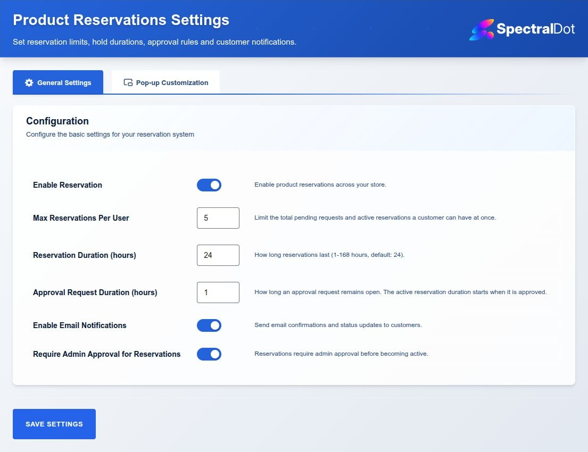
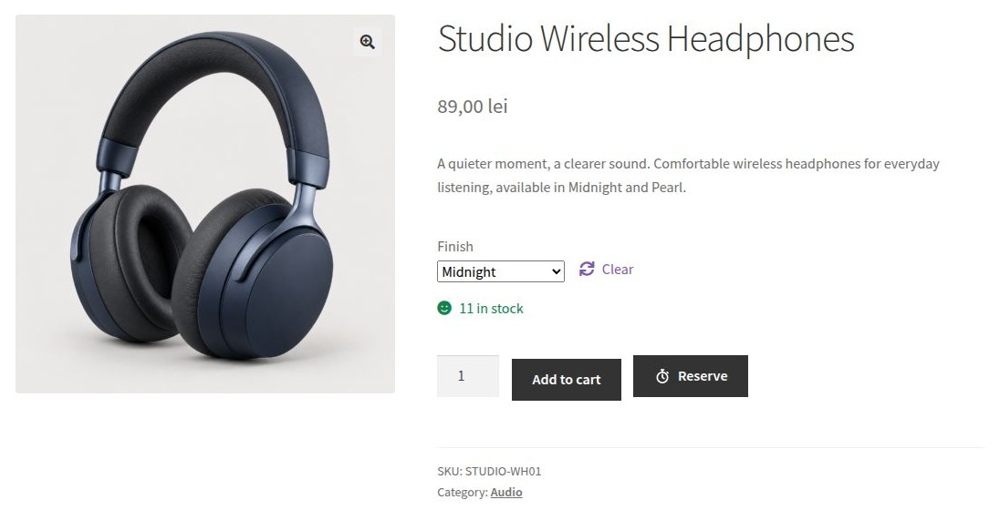
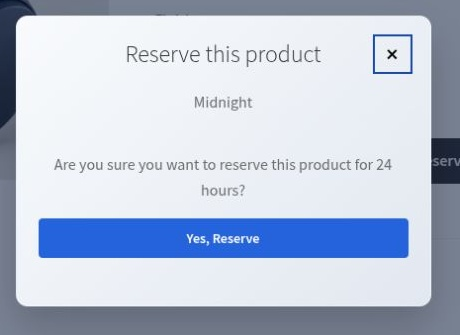
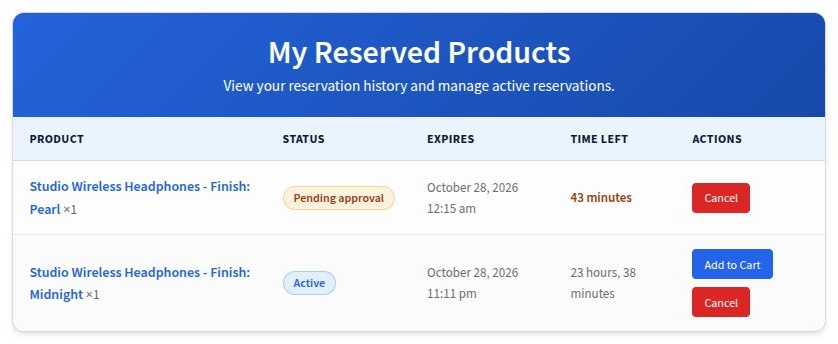
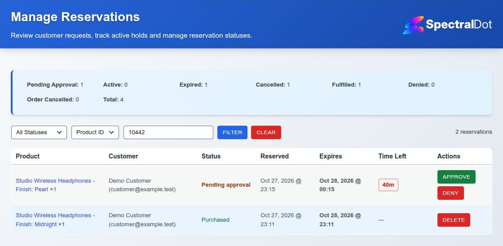
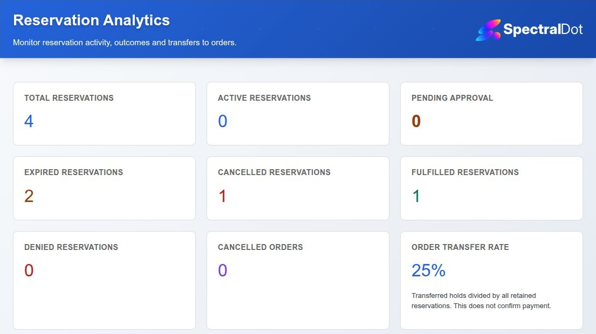

# WordPress.org Directory Assets

This folder is excluded from the plugin ZIP. Publish only the directory artwork listed below to the SVN repository's top-level `/assets`, not `/trunk/assets`. Keep this README and `source/` out of SVN directory assets.

## Files

- `icon.svg`: approved animated Spectral Dot icon, without the wordmark.
- `icon-128x128.png` and `icon-256x256.png`: static icon fallbacks.
- `banner-772x250.png` and `banner-1544x500.png`: approved midnight layered-wave banner.
- `screenshot-1.jpg`: reservation settings, durations, quota and approval options.
- `screenshot-2.jpg`: realistic variable product with a selected finish and Reserve beside Add to cart.
- `screenshot-3.jpg`: confirmation dialog showing the selected finish and duration.
- `screenshot-4.jpg`: customer account table with active and pending selected variations.
- `screenshot-5.jpg`: merchant reservation management, filtered to the demonstration product.
- `screenshot-6.jpg`: lifecycle summary cards and the explicitly explained order transfer rate.

Numbering matches the captions in `readme.txt`. Keep exactly one screenshot file per number.

## Capture Provenance

The 1.1.0 gallery was captured on 2026-10-27/28 from the local WooCommerce demonstration store. The storefront uses the separately installed Storefront 4.6.2 theme; that theme and its styling are not bundled with this plugin. Studio Wireless Headphones is a fictional demonstration product, with a local product photograph in `source/studio-headphones.png`. Customer records use generic demonstration details.

Images are genuine browser captures. Only rectangular cropping was applied: no interface controls were hidden, reconstructed or painted into the screenshots. WordPress toolbars, the admin sidebar, site navigation, test-site title and footer are excluded. Screenshot 6 intentionally frames the analytics header and summary cards, not the recent-record table. Screenshots 3 and 4 show states captured before the demonstration hold was transferred to an order or expired.

The gallery shows selected-option labels, updated customer action spacing, compact urgency badges, the current brand header and readable account heading/status colors. Screenshot 2 was refreshed after correcting the product buttons' inline baseline alignment; both buttons share the same top and bottom edges on desktop and wrap with a gap on narrow screens. It illustrates the product rather than certifying complete accessibility or every browser interaction. Automated checkout tests, visual observations and any remaining headed-browser limitations are recorded separately in the private update report.

## Gallery

### 1. Settings

### 2. Selected Variation

### 3. Confirmation

### 4. Customer Reservations

### 5. Merchant Management

### 6. Analytics

## Editable Sources and Publishing

`source/icon.svg` and `source/banner.svg` are the editable static masters. The animated icon is maintained separately as `icon.svg`; do not replace it by rerendering the static master. Recheck the approved standard and retina outputs after artwork changes.

Use `image/svg+xml` for SVG, `image/png` for PNG and `image/jpeg` for JPEG SVN MIME types. The animation is self-contained SVG, not JavaScript or an external runtime dependency. PNG icons remain available as static fallbacks. See the [official directory asset guidance](https://developer.wordpress.org/plugins/wordpress-org/plugin-assets/) before publishing.

Directory assets are deployed separately from the runtime release package. No automatic deployment is configured by this folder, and updating these files in Git does not publish them to WordPress.org.
